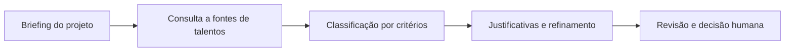

<div align="center">

# 💼 VINT Match

### Hackathon VINT + INBEC 2026 · VINT_GLOBAL

**Busca inteligente de talentos, ranking explicável e apoio à alocação de profissionais.**

**Participação: Sarah Belchior — gestão do projeto**

[**Explorar a demonstração pública**](demo/index.html) · [**Lógica de classificação**](demo/scoring.js) · [**Testes**](tests/ranking.test.js)

</div>

---

## ✦ Sobre o hackathon

O **VINT Match** foi apresentado no **Hackathon VINT + INBEC 2026**, em colaboração com a **VINT_GLOBAL**. O desafio consistia em reduzir o esforço necessário para identificar pessoas com as habilidades e a disponibilidade adequadas a uma demanda de projeto.

O estudo de caso registra **minha participação na gestão e estruturação da proposta**, em um trabalho colaborativo de hackathon. Este repositório **não é uma pesquisa científica** e não representa uma implantação oficial da solução.

## 🎯 Problema e proposta

Na situação apresentada, as informações de talentos estavam distribuídas entre dois contextos de consulta: **SGD** (colaboradores atuais) e **iHiring** (candidatos e talentos). A proposta reuniu os critérios de pesquisa em um fluxo único:



### Critérios de classificação apresentados no hackathon

| Critério | Peso |
|:--|--:|
| Competências (*skills*) | **40%** |
| Disponibilidade | **25%** |
| Histórico | **20%** |
| Aderência ao projeto | **15%** |

O relatório também descreve **refinamento contextual com IA**, ranking com justificativas, análise de disponibilidade ao longo do tempo e relatórios de alocação. Essas funcionalidades dizem respeito à **solução apresentada no hackathon**; a demonstração pública abaixo implementa somente um recorte simplificado.

## 🧪 Demonstração pública interativa

Para tornar o raciocínio técnico explorável sem expor dados da empresa, este repositório inclui uma **miniaplicação independente com dados 100% fictícios**.

**O que você consegue testar:**

- Informar competências necessárias, nível, disponibilidade mínima e período.
- Comparar perfis fictícios por critérios ponderados.
- Visualizar pontuação, competências faltantes e justificativas.
- Ver como a elegibilidade muda quando a disponibilidade não atende ao período.

> **Transparência:** o código em [`demo/`](demo/) foi elaborado especificamente como **demonstração educacional para este portfólio**. **Não é o código original do VINT Match**, não acessa o SGD/iHiring e não utiliza IA. Não deve ser usado para contratação ou alocação de pessoas reais.

### Como testar em menos de um minuto

1. Clique em **Code → Download ZIP** neste repositório.
2. Extraia o arquivo.
3. Abra [`demo/index.html`](demo/index.html) com dois cliques no navegador.
4. Altere os critérios e clique em **Comparar perfis fictícios**.

O exemplo usa HTML, CSS e JavaScript, sem cadastro, internet, instalação de bibliotecas ou APIs.

**Para quem avalia o código:** [`demo/scoring.js`](demo/scoring.js) implementa a ponderação, [`demo/app.js`](demo/app.js) apresenta resultados na interface e [`tests/ranking.test.js`](tests/ranking.test.js) valida casos de teste.

## 👩‍💻 Minha atuação

Atuei na **gestão do projeto do hackathon**, contribuindo para compreender o problema, organizar a proposta, estruturar critérios de solução e comunicar os resultados. A experiência envolveu colaboração em equipe e apresentação de uma solução tecnológica sob restrição de tempo.

**Competências exercitadas:** análise de requisitos · organização de projeto · comunicação técnica · resolução de problemas · trabalho colaborativo · compreensão de fluxos de dados e IA aplicada.

## 🛠️ Arquivos e tecnologias da demonstração

| Recurso | Finalidade |
|:--|:--|
| `demo/index.html` e `demo/style.css` | Interface responsiva |
| `demo/scoring.js` | Critérios e algoritmo didático de ranking |
| `demo/app.js` | Exibição e interação com perfis fictícios |
| `tests/ranking.test.js` | Testes unitários com Node.js |
| `.github/workflows/testes.yml` | Execução automatizada dos testes no GitHub |
| `docs/NOTAS-DE-ESCOPO.md` | Origem, limites e responsabilidade |

Para executar os testes locais com **Node.js 18+**:

```bash
node --test tests/ranking.test.js
```

Os testes também são executados pelo **GitHub Actions**, sem instalar dependências de terceiros.

## 🔐 Limites e responsabilidade

- Os perfis e todas as pontuações da demonstração são **inteiramente fictícios**.
- Não há divulgação de dados privados, currículos, credenciais ou código proprietário.
- A solução original foi um **protótipo de hackathon**; não apresento resultados de produção como comprovados.
- O ranking serve para **apoiar a análise**, nunca substituir uma decisão humana justa e fundamentada.

A contextualização parte do **Relatório do Projeto VINT Match — Hackathon VINT + INBEC 2026**, elaborado para a atividade. O relatório integral não é reproduzido aqui, em respeito ao material de trabalho e à colaboração com a empresa.

---

<div align="center">

**Sarah Belchior** · Desenvolvimento de software, inovação e projetos de impacto

[← Voltar ao meu perfil no GitHub](https://github.com/sarahbelchior)

</div>
